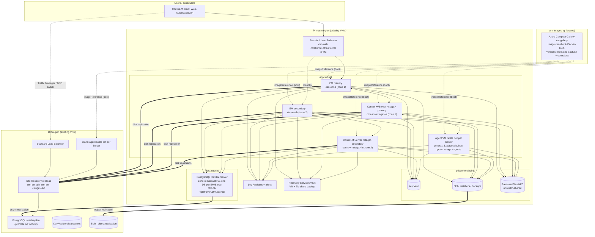

# Architecture

## Image pipeline (how the VMs are built and stored)

Every EM/Server VM and agent scale-set instance boots from the **ctm-rhel9**
golden image in the Azure Compute Gallery — never from the raw marketplace
image. The image is built by Packer and consumed by the Bicep compute modules:

```mermaid
flowchart LR
  MP["Marketplace base<br/>RedHat RHEL 9-lvm-gen2 (latest)"]
  PK["Packer build<br/>packer/ctm-rhel9.pkr.hcl<br/>(temporary build VM + RG)"]
  subgraph bake["Baked by packer/scripts/"]
    S0["00-packages.sh — Control-M prereq packages"]
    S1["10-os-tuning.sh — firewalld off, SELinux permissive,<br/>limits.d / sysctl.d tuning"]
    S2["20-nodejs.sh — Node.js 20 + npm"]
    S9["90-deprovision.sh — waagent deprovision, cloud-init clean"]
  end
  GAL["Compute Gallery ctmgallery (ctm-images-rg)<br/>image definition ctm-rhel9<br/>immutable versions x.y.z,<br/>replicated eastus2 + centralus"]
  CFG["environments/&lt;env&gt;/config.yaml<br/>image.image_version: latest | x.y.z"]
  DEP["ctmdeploy deploy --phase compute<br/>resolves the gallery image id,<br/>renders cloud-init per node"]
  NODES["EM / Server VMs (bicep/modules/node.bicep)<br/>+ agent VMSS (bicep/modules/agent-pool.bicep)<br/>imageReference = gallery image id"]
  CI["cloud-init at first boot (environment-specific only):<br/>KV secrets via IMDS, data-disk mount, NFS mount,<br/>Control-M install, systemd units, agent registration"]

  MP --> PK --> bake --> GAL
  GAL --> DEP
  CFG --> DEP
  DEP --> NODES --> CI
```

| Baked into the image (Packer, once per version) | Done at boot (cloud-init, per node) |
|---|---|
| OS packages (jq, curl, nfs-utils, libnsl/libnsl2, ncurses, xfsprogs, chrony, …) | fetch secrets from Key Vault with the IMDS token |
| firewalld disabled (NSGs are the boundary), SELinux permissive | format/mount the persistent `/ctm` data disk |
| `limits.d` / `sysctl.d` Control-M tuning | mount the NFS share, DNS search domain |
| Node.js 20 + npm (Automation API CLI) | download BMC media, silent install, systemd units |
| deprovision + cloud-init reset | EM/Server/Agent role config, registration, backup cron |

No secrets are ever baked into the image or embedded in cloud-init. Gallery
versions are immutable: a change to `packer/scripts/*` means a new version
(`ctmdeploy image build --version x.y.z`), then a bump of
`image.image_version` in config and a `--phase compute` deployment; nodes are
re-created on the new image and reattach their persistent data disks. Version
replication to both regions means DR failover and the warm agent scale set use
the same bits as the primary.

## Design decisions

**Why two platforms instead of four.** Control-M's own hierarchy already
separates stages: one Enterprise Manager manages many Control-M/Servers, and
each Server has its own agents, host groups, folders and authorizations. The
prod platform hosts `CTM_UAT` next to `CTM_PROD` so acceptance testing runs on
the exact infrastructure, EM version, database host and DR path that
production uses. The nonprod platform hosts `CTM_DEV` and `CTM_QA` and is where
EM/Server upgrades and patches are rehearsed first. Stage boundaries are
Server boundaries (separate VMs, databases, credentials, agent pools), so a
runaway dev scheduler cannot touch qa, and uat cannot touch prod, while the
control plane is shared. Adding a stage or splitting one out to its own
platform is a `config.yaml` change.

**Why VMs and not Kubernetes for EM/Server.** BMC supports the EM and Server
components on Linux hosts with a shared external PostgreSQL. Their HA model is
an active/standby pair bound to stable hostnames and a shared database, which
maps directly onto two zonal VMs with persistent data disks. Agents, which are
stateless from the platform's point of view, go into a scale set.

**Why a golden image instead of boot-time OS prep.** Baking packages, kernel
tuning and Node.js into **ctm-rhel9** makes every node boot identical and
fast, removes first-boot internet dependencies for OS prep, and turns OS drift
into a versioned, reviewable artifact. Cloud-init keeps only what genuinely
differs per environment and node (secrets, names, mounts, Control-M install).

**Why one foundation template with a `role`.** The DR region needs the same
foundation (identity, secrets, storage, LB, monitoring, DNS aliases) but not
the database or VMs, which arrive through replication. Reusing
`bicep/foundation.bicep` with `role = 'dr'` keeps the two regions drift-free.

**Why aliases instead of real hostnames in Control-M config.** Nodes connect
to `ctm-db.<platform>.ctm.internal` and `ctm-web.<platform>.ctm.internal`. The same zone
name exists in both regions, linked to each region's VNet. After failover the
CNAME in the DR zone points at the promoted replica and Site Recovery brings
the VMs up with their original hostnames, so Control-M starts unchanged.

**Why PostgreSQL Flexible Server.** Zone-redundant HA with automatic failover,
geo-redundant backups and cross-region read replicas cover HA and DR without
database administration on the VMs. Control-M supports external PostgreSQL.

**Why Premium Files NFS.** Installer media cache, EM/Server backup exports and
shared logs need a POSIX filesystem reachable from every node in every zone.
Premium ZRS Files over NFS 4.1 through a private endpoint provides that.

**Why Site Recovery for VMs.** The Control-M installation is tied to the host
(home directory, hostname, local config). Replicating the OS and data disks
gives an identical host in the DR region in minutes, versus re-installing and
re-registering a secondary EM/Server across regions.

**Why stateless deployments.** Bicep deployments are compared against what
exists in Azure on every run, so there is no state file to store, lock, back
up or drift from. `ctmdeploy whatif` previews changes; `ctmdeploy deploy`
re-runs the same deployments idempotently, phase by phase
(rg → foundation → secrets → compute → dr → replication).

**Scaling.** Each Server's agent pool scales horizontally on CPU with its own min/max and
deregister gracefully on scale-in via Azure Scheduled Events. EM, Server and
database scale vertically by changing one `config.yaml` value; the data disks and
database storage auto-grow.

## Identity and secrets

* One user-assigned managed identity per region for all nodes. Rights:
  Key Vault Secrets User, Storage Blob Data Reader (installers), Storage Blob
  Data Contributor (backups container).
* All passwords and the SSH key are generated once by `ctmdeploy secrets`
  (or `deploy --phase secrets`) and written to the Key Vault in every region.
  Seeding is idempotent: a secret already in the vault is never rotated
  silently; external overrides arrive through the `CTM_PLATFORM_SECRETS`
  environment variable (JSON map, wired to Delinea DSV in the pipeline).
  The SSH private key is available as the `ssh-private-key` secret.
* No secrets are embedded in cloud-init or in the golden image; nodes fetch
  them with the IMDS token at boot.
