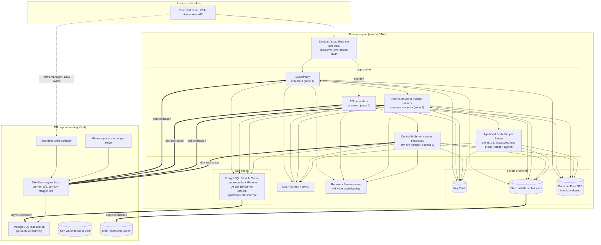

# Architecture

## Design decisions

**Why two platforms instead of four.** Control-M's own hierarchy already
separates stages: one Enterprise Manager manages many Control-M/Servers, and
each Server has its own agents, host groups, folders and authorizations. The
prod platform hosts `CTM_UAT` next to `CTM_PROD` so acceptance testing runs on
the exact infrastructure, EM version, database host and DR path that
production uses. The nonprod platform hosts `CTM_DEV` and `CTM_QA` and is where
EM/Server upgrades and patches are rehearsed first. Stage boundaries are
Server boundaries (separate VMs, databases, credentials, agent pools), so a
runaway dev scheduler cannot touch qa, and uat cannot touch prod, while the
control plane is shared. Adding a stage or splitting one out to its own
platform is a tfvars change.

**Why VMs and not Kubernetes for EM/Server.** BMC supports the EM and Server
components on Linux hosts with a shared external PostgreSQL. Their HA model is
an active/standby pair bound to stable hostnames and a shared database, which
maps directly onto two zonal VMs with persistent data disks. Agents, which are
stateless from the platform's point of view, go into a scale set.

**Why one composition module with a `role`.** The DR region needs the same
foundation (identity, secrets, storage, LB, monitoring, DNS aliases) but not
the database or VMs, which arrive through replication. Reusing `modules/platform`
with `role = "dr"` keeps the two regions drift-free.

**Why aliases instead of real hostnames in Control-M config.** Nodes connect
to `ctm-db.<platform>.ctm.internal` and `ctm-web.<platform>.ctm.internal`. The same zone
name exists in both regions, linked to each region's VNet. After failover the
CNAME in the DR zone points at the promoted replica and Site Recovery brings
the VMs up with their original hostnames, so Control-M starts unchanged.

**Why PostgreSQL Flexible Server.** Zone-redundant HA with automatic failover,
geo-redundant backups and cross-region read replicas cover HA and DR without
database administration on the VMs. Control-M supports external PostgreSQL.

**Why Premium Files NFS.** Installer media cache, EM/Server backup exports and
shared logs need a POSIX filesystem reachable from every node in every zone.
Premium ZRS Files over NFS 4.1 through a private endpoint provides that.

**Why Site Recovery for VMs.** The Control-M installation is tied to the host
(home directory, hostname, local config). Replicating the OS and data disks
gives an identical host in the DR region in minutes, versus re-installing and
re-registering a secondary EM/Server across regions.

**Scaling.** Each Server's agent pool scales horizontally on CPU with its own min/max and
deregister gracefully on scale-in via Azure Scheduled Events. EM, Server and
database scale vertically by changing one tfvars value; the data disks and
database storage auto-grow.

## Identity and secrets

* One user-assigned managed identity per region for all nodes. Rights:
  Key Vault Secrets User, Storage Blob Data Reader (installers), Storage Blob
  Data Contributor (backups container).
* All passwords and the SSH key are generated once by Terraform in the
  environment root (`secrets.tf`) and written to the Key Vault in every region.
  The SSH private key is available as the `ssh-private-key` secret.
* No secrets are embedded in cloud-init; nodes fetch them with the IMDS token.
