# Architecture

Every tier's network placement is **config-driven**: the Enterprise Manager
and all shared services (load balancer, database, private endpoints) live in a
per-platform **utility VNet** (`network.utility`), while every Control-M/Server
runs in its **own VNet** (`servers.<stage>.network`) with its agent scale set
beside it. Server VNets peer only with the utility VNet — never with each
other — so each server+agent couple is fully isolated at the network layer.
The DR region mirrors the layout: a DR utility VNet (`dr.network.utility`)
plus one DR VNet per DR-protected Server (`dr.server_networks.<stage>`; in the
shipped prod config only CTM_PROD participates). The VNets either pre-exist
(bring-your-own, the default) or are provisioned by the optional network
phase (`network_infrastructure.create: true` → `bicep/network.bicep`); see
`docs/NETWORK-REQUIREMENTS.md` for both options, the PoC address plan and the
required subnets, peering and NSGs.

```mermaid
flowchart TB
  subgraph users[Users / schedulers]
    U[Control-M client, Web, Automation API]
  end

  subgraph gallery["ctm-images-rg (shared)"]
    GAL["Azure Compute Gallery ctmgallery<br/>image ctm-rhel9 (Packer-built,<br/>versions replicated eastus2 + centralus)"]
  end

  subgraph primary["Primary region — existing VNets, hub-and-spoke per platform"]
    subgraph util["utility VNet (vnet-dev-utility / vnet-prod-utility)"]
      subgraph emsub[em subnet]
        LB["Standard Load Balancer<br/>ctm-web.&lt;platform&gt;.ctm.internal :8443"]
        EMA["EM primary<br/>ctm-em-a (zone 1)"]
        EMB["EM secondary<br/>ctm-em-b (zone 2)"]
      end
      subgraph datasub["data subnet (delegated)"]
        PG["PostgreSQL Flexible Server<br/>zone-redundant HA, one DB per EM/Server<br/>ctm-db.&lt;platform&gt;.ctm.internal"]
      end
      subgraph pesub["pe subnet (private endpoints)"]
        KV[(Key Vault)]
        BLOB[(Blob: installers / backups)]
        NFS[(Premium Files NFS<br/>/mnt/ctm-shared)]
      end
    end
    subgraph spoke["server VNet per stage (vnet-ctm-&lt;stage&gt;)<br/>peered to the utility VNet ONLY — never to another server VNet"]
      subgraph srvsub[server subnet]
        SRVA["Control-M/Server &lt;stage&gt; primary<br/>ctm-srv-&lt;stage&gt;-a (zone 1)"]
        SRVB["Control-M/Server &lt;stage&gt; secondary<br/>ctm-srv-&lt;stage&gt;-b (zone 2)"]
      end
      subgraph agsub[agents subnet]
        VMSS["Agent VM Scale Set per Server<br/>zones 1-3, autoscale, host group &lt;stage&gt;-agents"]
      end
    end
    LAW[Log Analytics + alerts]
    RSV[Recovery Services vault<br/>VM + file share backup]
  end

  subgraph dr["DR region — existing VNets, same hub-and-spoke"]
    subgraph drutil["DR utility VNet (vnet-dr-utility)"]
      LBD[Standard Load Balancer]
      PGR["PostgreSQL read replica<br/>all databases, ctm_uat included<br/>(promote on failover)"]
      ASREM["Site Recovery target: ctm-em-a/b<br/>(em subnet)"]
      KVD[(Key Vault replica secrets)]
      BLOBD[(Blob - object replication)]
    end
    subgraph drspoke["DR server VNet per DR-protected stage (vnet-ctm-prod-dr)"]
      ASRSRV["Site Recovery target: ctm-srv-prod-a/b<br/>(server subnet)"]
      VMSSD["Warm agent scale set<br/>(agents subnet)"]
    end
  end

  GAL -. "imageReference (boot)" .-> EMA & EMB & SRVA & SRVB & VMSS & VMSSD
  U --> LB
  LB --> EMA
  LB -. standby .-> EMB
  EMA <-->|"2369 + dynamic ports, via peering"| SRVA
  EMB <-->|"2369 + dynamic ports, via peering"| SRVB
  SRVA <-->|7005-7006| VMSS
  VMSS -->|"8443, via peering"| LB
  EMA & EMB --> PG
  SRVA & SRVB -->|"5432, via peering"| PG
  EMA & EMB & SRVA & SRVB & VMSS -->|"443 / 2049"| KV & BLOB & NFS
  EMA & EMB & SRVA & SRVB & VMSS --> LAW
  EMA & EMB & SRVA & SRVB --> RSV
  PG == async replication ==> PGR
  EMA & EMB == disk replication ==> ASREM
  SRVA & SRVB == "disk replication (DR-protected stages only)" ==> ASRSRV
  BLOB == object replication ==> BLOBD
  U -. Traffic Manager / DNS switch .-> LBD
  LBD --> ASREM
  ASREM --> PGR
  VMSSD --> ASRSRV
```

## Image pipeline (how the VMs are built and stored)

Every EM/Server VM and agent scale-set instance boots from the **ctm-rhel9**
golden image in the Azure Compute Gallery — never from the raw marketplace
image. The image is built by Packer and consumed by the Bicep compute modules.

**The image contains the operating system only.** It is RHEL 9 plus the OS
prep (packages, firewalld off, SELinux permissive, limits/sysctl tuning,
Node.js 20, deprovision) — **no BMC software is ever baked into it**. The
Control-M software is installed at provision time, on each node's first boot:

* **EM and Control-M/Server** — cloud-init downloads the BMC EPD archive and
  the silent-install XML from the `installers` blob container (via managed
  identity) and runs the BMC silent installer onto the persistent `/ctm` data
  disk.
* **Agents** — cloud-init installs the Automation API CLI served by EM and
  provisions the agent through the **EM Automation API** (`ctm provision
  image` / `ctm provision agent::setup`); no installer media is downloaded.

The installer media itself is sourced from an **Azure Artifacts feed**
(Universal Packages) and moved into the blob containers by the pipeline's
media stage or `ctmdeploy media upload` — see `docs/AZURE-DEVOPS.md` §5. This
split means a new BMC version is a media + config change, while a new OS
patch level is an image version bump; neither requires the other.

```mermaid
flowchart LR
  MP["Marketplace base<br/>RedHat RHEL 9-lvm-gen2 (latest)"]
  PK["Packer build<br/>packer/ctm-rhel9.pkr.hcl<br/>(temporary build VM + RG)"]
  subgraph bake["Baked by packer/scripts/"]
    S0["00-packages.sh — Control-M prereq packages"]
    S1["10-os-tuning.sh — firewalld off, SELinux permissive,<br/>limits.d / sysctl.d tuning"]
    S2["20-nodejs.sh — Node.js 20 + npm"]
    S9["90-deprovision.sh — waagent deprovision, cloud-init clean"]
  end
  GAL["Compute Gallery ctmgallery (ctm-images-rg)<br/>image definition ctm-rhel9<br/>immutable versions x.y.z,<br/>replicated eastus2 + centralus"]
  CFG["environments/&lt;env&gt;/config.yaml<br/>image.image_version: latest | x.y.z"]
  DEP["ctmdeploy deploy --phase compute<br/>resolves the gallery image id,<br/>renders cloud-init per node"]
  NODES["EM / Server VMs (bicep/modules/node.bicep)<br/>+ agent VMSS (bicep/modules/agent-pool.bicep)<br/>imageReference = gallery image id"]
  CI["cloud-init at first boot (environment-specific only):<br/>KV secrets via IMDS, data-disk mount, NFS mount,<br/>Control-M install, systemd units, agent registration"]

  MP --> PK --> bake --> GAL
  GAL --> DEP
  CFG --> DEP
  DEP --> NODES --> CI
```

| Baked into the image (Packer, once per version) | Done at boot (cloud-init, per node) |
|---|---|
| OS packages (jq, curl, nfs-utils, libnsl/libnsl2, ncurses, xfsprogs, chrony, …) | fetch secrets from Key Vault with the IMDS token |
| firewalld disabled (NSGs are the boundary), SELinux permissive | format/mount the persistent `/ctm` data disk |
| `limits.d` / `sysctl.d` Control-M tuning | mount the NFS share, DNS search domain |
| Node.js 20 + npm (Automation API CLI) | download BMC media, silent install, systemd units |
| deprovision + cloud-init reset | EM/Server/Agent role config, registration, backup cron |

No secrets are ever baked into the image or embedded in cloud-init. Gallery
versions are immutable: a change to `packer/scripts/*` means a new version
(`ctmdeploy image build --version x.y.z`), then a bump of
`image.image_version` in config and a `--phase compute` deployment; nodes are
re-created on the new image and reattach their persistent data disks. Version
replication to both regions means DR failover and the warm agent scale set use
the same bits as the primary.

## Design decisions

**Why two platforms instead of four.** Control-M's own hierarchy already
separates stages: one Enterprise Manager manages many Control-M/Servers, and
each Server has its own agents, host groups, folders and authorizations. The
prod platform hosts `CTM_UAT` next to `CTM_PROD` so acceptance testing runs on
the exact infrastructure, EM version, database host and DR path that
production uses. The nonprod platform hosts `CTM_DEV` and `CTM_QA` and is where
EM/Server upgrades and patches are rehearsed first. Stage boundaries are
Server boundaries (separate VMs, databases, credentials, agent pools) **and
network boundaries** (each Server and its agents in their own VNet), so a
runaway dev scheduler cannot touch qa, and uat cannot touch prod, while the
control plane is shared. Adding a stage or splitting one out to its own
platform is a `config.yaml` change.

**Why a utility VNet plus isolated server VNets.** The EM, load balancer,
database and private endpoints are shared services — they belong in one
per-platform utility VNet. Each Control-M/Server and its agent pool are a
stage-private workload — they get their own VNet, peered to the utility VNet
only. Isolation then holds at the network layer, not just in Control-M
authorizations: no peering between server VNets means no path between stages,
and the blast radius of a compromised agent subnet is one stage. Placement is
entirely config (`network.utility`, `servers.<stage>.network`,
`dr.network.utility`, `dr.server_networks`): moving a tier — including
relocating a stage's agents to another VNet via
`servers.<stage>.network.agents_vnet_name` — is a config change and a
`--phase compute` (or `foundation`) deployment, not a code change.

**Why VMs and not Kubernetes for EM/Server.** BMC supports the EM and Server
components on Linux hosts with a shared external PostgreSQL. Their HA model is
an active/standby pair bound to stable hostnames and a shared database, which
maps directly onto two zonal VMs with persistent data disks. Agents, which are
stateless from the platform's point of view, go into a scale set.

**Why a golden image instead of boot-time OS prep.** Baking packages, kernel
tuning and Node.js into **ctm-rhel9** makes every node boot identical and
fast, removes first-boot internet dependencies for OS prep, and turns OS drift
into a versioned, reviewable artifact. Cloud-init keeps only what genuinely
differs per environment and node (secrets, names, mounts, Control-M install).

**Why one foundation template with a `role`.** The DR region needs the same
foundation (identity, secrets, storage, LB, monitoring, DNS aliases) but not
the database or VMs, which arrive through replication. Reusing
`bicep/foundation.bicep` with `role = 'dr'` — pointed at the DR utility VNet
and the DR server VNets — keeps the two regions drift-free.

**Why aliases instead of real hostnames in Control-M config.** Nodes connect
to `ctm-db.<platform>.ctm.internal` and `ctm-web.<platform>.ctm.internal`. The same zone
name exists in both regions, linked to every VNet of that region's platform
(utility + each server VNet, auto-registration on). After failover the
CNAME in the DR zone points at the promoted replica and Site Recovery brings
the VMs up with their original hostnames, so Control-M starts unchanged.

**Why PostgreSQL Flexible Server.** Zone-redundant HA with automatic failover,
geo-redundant backups and cross-region read replicas cover HA and DR without
database administration on the VMs. Control-M supports external PostgreSQL.

**Why Premium Files NFS.** Installer media cache, EM/Server backup exports and
shared logs need a POSIX filesystem reachable from every node in every zone.
Premium ZRS Files over NFS 4.1 through a private endpoint provides that.

**Why Site Recovery for VMs.** The Control-M installation is tied to the host
(home directory, hostname, local config). Replicating the OS and data disks
gives an identical host in the DR region in minutes, versus re-installing and
re-registering a secondary EM/Server across regions.

**Why stateless deployments.** Bicep deployments are compared against what
exists in Azure on every run, so there is no state file to store, lock, back
up or drift from. `ctmdeploy whatif` previews changes; `ctmdeploy deploy`
re-runs the same deployments idempotently, phase by phase
(rg → foundation → secrets → compute → dr → replication).

**Scaling.** Each Server's agent pool scales horizontally on CPU with its own min/max and
deregister gracefully on scale-in via Azure Scheduled Events. EM, Server and
database scale vertically by changing one `config.yaml` value; the data disks and
database storage auto-grow.

## Identity and secrets

* One user-assigned managed identity per region for all nodes. Rights:
  Key Vault Secrets User, Storage Blob Data Reader (installers), Storage Blob
  Data Contributor (backups container).
* All passwords and the SSH key are generated once by `ctmdeploy secrets`
  (or `deploy --phase secrets`) and written to the Key Vault in every region.
  Seeding is idempotent: a secret already in the vault is never rotated
  silently; external overrides arrive through the `CTM_PLATFORM_SECRETS`
  environment variable (JSON map, wired to Delinea DSV in the pipeline).
  The SSH private key is available as the `ssh-private-key` secret.
* No secrets are embedded in cloud-init or in the golden image; nodes fetch
  them with the IMDS token at boot. The full secret inventory — who creates
  each one, who consumes it and when, and how to rotate it — is
  `docs/KEYVAULT.md`.

## Related documents

* `docs/SETUP.md` — end-to-end setup order (network → feed → image → deploy →
  media → verify → pipeline → DR drill).
* `docs/CONFIGURATION.md` — every `config.yaml` key, type, default and the
  phase that consumes it.
* `docs/RESOURCES.md` — the complete inventory of deployed resources, by
  phase, including the python-created data-plane items.
* `docs/KEYVAULT.md` — Key Vault posture and secret handling.
* `docs/NETWORK-REQUIREMENTS.md` — Option A (repo-created network, PoC
  address plan) and the BYO contract, plus the private-endpoint and DNS
  inventory.
* `docs/AZURE-DEVOPS.md` — pipeline, Delinea DSV, Checkmarx, the Azure
  Artifacts media feed.
* `docs/OPERATIONS.md`, `docs/DR-RUNBOOK.md` — day-2 and failover.
