# Architecture

Every tier's network placement is **config-driven**: the Enterprise Manager
and all shared services (load balancer, database, private endpoints) live in a
per-platform **utility VNet** (`network.utility`), while every Control-M/Server
runs in its **own VNet** (`servers.<stage>.network`) with its agent scale set
beside it. Server VNets peer only with the utility VNet — never with each
other — so each server+agent couple is fully isolated at the network layer.
The DR region mirrors the layout: a DR utility VNet (`dr.network.utility`)
plus one DR VNet per DR-protected Server (`dr.server_networks.<stage>`; in the
shipped prod config only CTM_PROD participates). The VNets either pre-exist
(bring-your-own, the default) or come from the standalone **`network/`
folder** — cloud-team-owned Bicep the pipeline can also deploy
(`network_infrastructure.create: true` → `network/main.bicep`); see
`docs/NETWORK-REQUIREMENTS.md` for both options, the PoC address plan and the
required subnets, peering and NSGs.

The **access layer** (deployed by the `access` phase, after compute) rides
the utility VNets: **Azure Bastion** gives operators private SSH to every
node (DR included, over the prod ⇄ DR global peering) with no VM ever
carrying a public IP; on prod a **private Application Gateway** (layer-4 TCP
443/8443, static private frontend, backend pool = the primary **and** DR
internal LB frontends) publishes **`ctm-global`** — a single alias that
follows whichever region's EM answers the TCP health probe, giving automatic
primary/DR behavior. With `access.appgw.dr_instance` (the shipped prod
config) the gateway gets a **DR twin** in the DR utility VNet — same two-LB
backend pool, its own private frontend — and each regional copy of the
platform zone resolves `ctm-global` to its **local** gateway, so the private
entry point itself survives a primary-region loss (the twin pattern); and
the **kvsync Durable Function** (VNet-integrated
into `snet-ctm-func`) mirrors Key Vault secrets tagged `ctm-sync=true` into
Control-M's secret store through the EM Automation API. A dedicated **build
VNet** hosts the `ctm-build-agents` scale set — Azure DevOps elastic-pool
agents that deploy into nonprod, prod and DR over peerings to all three
utility VNets.

```mermaid
flowchart TB
  subgraph users[Users / schedulers]
    U[Control-M client, Web, Automation API]
  end

  subgraph gallery["ctm-images-rg (shared)"]
    GAL["Azure Compute Gallery ctmgallery<br/>images ctm-rhel9 (OS) + ctm-agent<br/>(agent baked in; Packer-built, versions<br/>replicated eastus2 + centralus)"]
  end

  subgraph primary["Primary region — existing VNets, hub-and-spoke per platform"]
    subgraph util["utility VNet (vnet-dev-utility / vnet-prod-utility)"]
      subgraph emsub[em subnet]
        LB["Standard Load Balancer<br/>ctm-web.&lt;platform&gt;.ctm.internal :8443"]
        EMA["EM primary<br/>ctm-em-a (zone 1)"]
        EMB["EM secondary<br/>ctm-em-b (zone 2)"]
      end
      subgraph datasub["data subnet (delegated)"]
        PG["PostgreSQL Flexible Server<br/>zone-redundant HA, one DB per EM/Server<br/>ctm-db.&lt;platform&gt;.ctm.internal"]
      end
      subgraph pesub["pe subnet (private endpoints)"]
        KV[(Key Vault)]
        BLOB[(Blob: installers / backups)]
        NFS[(Premium Files NFS<br/>/mnt/ctm-shared)]
      end
      subgraph accsub["access subnets (v4)"]
        BAS["Azure Bastion<br/>AzureBastionSubnet"]
        AGW["private Application Gateway, L4 TCP<br/>ctm-global.&lt;platform&gt;.ctm.internal<br/>snet-ctm-appgw (prod only)"]
        FUNC["kvsync Durable Function<br/>VNet-integrated, snet-ctm-func"]
      end
    end
    subgraph spoke["server VNet per stage (vnet-ctm-&lt;stage&gt;)<br/>peered to the utility VNet ONLY — never to another server VNet"]
      subgraph srvsub[server subnet]
        SRVA["Control-M/Server &lt;stage&gt; primary<br/>ctm-srv-&lt;stage&gt;-a (zone 1)"]
        SRVB["Control-M/Server &lt;stage&gt; secondary<br/>ctm-srv-&lt;stage&gt;-b (zone 2)"]
      end
      subgraph agsub[agents subnet]
        VMSS["Agent VM Scale Set per Server<br/>zones 1-3, autoscale, host group &lt;stage&gt;-agents"]
      end
    end
    LAW[Log Analytics + alerts]
    RSV[Recovery Services vault<br/>VM + file share backup]
  end

  subgraph build["build VNet (vnet-ctm-build, prod) — peered to ALL THREE utility VNets"]
    BUILD["ctm-build-agents VMSS<br/>Azure DevOps elastic pool<br/>deploys nonprod + prod + DR"]
  end

  subgraph dr["DR region — existing VNets, same hub-and-spoke"]
    subgraph drutil["DR utility VNet (vnet-dr-utility)"]
      LBD[Standard Load Balancer]
      PGR["PostgreSQL read replica<br/>all databases, ctm_uat included<br/>(promote on failover)"]
      ASREM["Site Recovery target: ctm-em-a/b<br/>(em subnet)"]
      AGWD["DR gateway TWIN, L4 TCP<br/>ctm-global via the DR zone copy<br/>snet-ctm-appgw (access.appgw.dr_instance)"]
      KVD[(Key Vault replica secrets)]
      BLOBD[(Blob - object replication)]
    end
    subgraph drspoke["DR server VNet per DR-protected stage (vnet-ctm-prod-dr)"]
      ASRSRV["Site Recovery target: ctm-srv-prod-a/b<br/>(server subnet)"]
      VMSSD["Warm agent scale set<br/>(agents subnet)"]
    end
  end

  GAL -. "imageReference (boot)" .-> EMA & EMB & SRVA & SRVB & VMSS & VMSSD
  U -->|"443/8443 ctm-global"| AGW
  AGW -->|"8443 + TCP probe"| LB
  AGW ==>|"8443 via utility-to-utility GLOBAL peering"| LBD
  U -.->|"443/8443 ctm-global (DR zone copy)"| AGWD
  AGWD -->|"8443 + TCP probe"| LBD
  AGWD ==>|"8443 via the GLOBAL peering"| LB
  U --> LB
  LB --> EMA
  LB -. standby .-> EMB
  BAS -. "SSH 22 (DR too, via global peering)" .-> EMA & SRVA & VMSS & BUILD
  FUNC -->|"443 (tagged secrets)"| KV
  FUNC -->|"8443 Automation API"| LB
  BUILD -->|"443: ARM, Azure DevOps, KV/blob PEs via peering"| KV
  EMA <-->|"2369 + dynamic ports, via peering"| SRVA
  EMB <-->|"2369 + dynamic ports, via peering"| SRVB
  SRVA <-->|7005-7006| VMSS
  VMSS -->|"8443, via peering"| LB
  EMA & EMB --> PG
  SRVA & SRVB -->|"5432, via peering"| PG
  EMA & EMB & SRVA & SRVB & VMSS -->|"443 / 2049"| KV & BLOB & NFS
  EMA & EMB & SRVA & SRVB & VMSS --> LAW
  EMA & EMB & SRVA & SRVB --> RSV
  PG == async replication ==> PGR
  EMA & EMB == disk replication ==> ASREM
  SRVA & SRVB == "disk replication (DR-protected stages only)" ==> ASRSRV
  BLOB == object replication ==> BLOBD
  U -. Traffic Manager / DNS switch .-> LBD
  LBD --> ASREM
  ASREM --> PGR
  VMSSD --> ASRSRV
```

## Image pipeline (how the VMs are built and stored)

v4.1 **two-image model**: every VM boots a golden image from the Azure
Compute Gallery — never the raw marketplace image — and there are TWO image
definitions, both Packer-built and consumed by the Bicep compute modules:

* **ctm-rhel9 (base)** — EM and Control-M/Server VMs. **Operating system
  only**: RHEL 9 plus the OS prep (packages, firewalld off, SELinux
  permissive, limits/sysctl tuning, Node.js 20, deprovision) — **no BMC
  software is ever baked into it**.
* **ctm-agent** — the agent VM scale sets. The same OS prep **plus the
  Control-M/Agent silent-installed at image-build time** from the
  `control-m-agent` Azure Artifacts package (placeholder server settings,
  never started, never registered, media removed before capture). The agent
  is the ONLY BMC software in any image, and only in this one.

EM/Server software is installed at provision time, on each node's first
boot; agents only get CONFIGURED at boot. Both run through **one idempotent
python script**:

* A **thin cloud-init shim** (rendered from `cloud-init/*.tmpl`, never
  carrying a secret) prepares the OS plumbing — DNS search domain, persistent
  data disk, NFS mount — writes `/etc/ctm/node.json` (names and ids only),
  fetches `node-scripts/ctm_node_install.py` from the installers blob
  container via managed identity (the compute phase uploads the repo's
  version first, so script and infrastructure always match) and runs it. A
  `ctm-install.service` systemd oneshot re-runs it on demand.
* The installer is **stdlib-only python 3** (urllib/subprocess/fcntl — it
  runs on RHEL 9's system python, no pip on nodes) and a **stage machine**:
  progress lands in `/var/lib/ctm/install-state.json` and every stage also
  checks real-world done-ness (`.ctm_installed` on the persistent `/ctm`
  disk survives VM rebuilds; the NFS media cache carries `.extracted`
  markers with an flock around extraction), so re-running at any time is
  safe.
* **EM and Control-M/Server** — wait-for-dependencies (secondaries wait for
  the primary), fetch secrets from Key Vault via IMDS (in memory only),
  download the EPD archive from blob into the shared media cache, render the
  silent-install XML (0600, deleted right after), run BMC `setup.sh -silent`
  onto the persistent `/ctm` data disk, install the systemd units (EM also
  gets the nightly backup cron).
* **Agents** — no media download, no install (the agent is **baked into the
  ctm-agent image**): write the real server name/ports/hostname into the
  baked agent's `CONFIG.dat`, start it (systemd unit), **register through
  the EM Automation API REST** (session login + host-group add) and install
  the scheduled-events watcher that deregisters gracefully on
  scale-in/eviction. Node.js stays in the image but is not required at
  runtime. (Instances still fetch `scripts/ctm_node_install.py` from blob
  via managed identity — a 403 fails fast with the exact missing role.)

The installer media is sourced from an **Azure Artifacts feed** (Universal
Packages): the EM/Server archives + silent XMLs are moved into the blob
containers by the pipeline's media stage or `ctmdeploy media upload`, while
the **`control-m-agent` package feeds the Packer ctm-agent build** (the
pipeline image stage with `imageKind=agent`) and never touches blob — see
`docs/AZURE-DEVOPS.md` §5. A new EM/Server version is a media + config
change; a new agent version is a ctm-agent image bump; a new OS patch level
is a base (and agent) image version bump.

```mermaid
flowchart LR
  MP["Marketplace base<br/>RedHat RHEL 9-lvm-gen2 (latest)"]
  PK["Packer builds<br/>packer/ctm-rhel9.pkr.hcl (base)<br/>packer/ctm-agent.pkr.hcl (agent)<br/>(temporary build VM + RG each)"]
  subgraph bake["Baked by packer/scripts/"]
    S0["00-packages.sh — Control-M prereq packages"]
    S1["10-os-tuning.sh — firewalld off, SELinux permissive,<br/>limits.d / sysctl.d tuning"]
    S2["20-nodejs.sh — Node.js 20 + npm"]
    S3["30-agent-install.sh — ctm-agent ONLY:<br/>Control-M/Agent silent install from the<br/>control-m-agent package media (placeholder<br/>config, not started, media cleaned)"]
    S9["90-deprovision.sh — waagent deprovision, cloud-init clean"]
  end
  GAL["Compute Gallery ctmgallery (ctm-images-rg)<br/>definitions ctm-rhel9 (base) + ctm-agent<br/>immutable versions x.y.z,<br/>replicated eastus2 + centralus"]
  CFG["environments/&lt;env&gt;/config.yaml<br/>image.base / image.agent: {definition, version}"]
  DEP["ctmdeploy deploy --phase compute<br/>resolves imageId (base) + agentImageId (agent),<br/>renders cloud-init per node"]
  NODES["EM / Server VMs (bicep/modules/node.bicep) ← base image<br/>agent VMSS (bicep/modules/agent-pool.bicep) ← agent image"]
  CI["first boot: thin cloud-init shim writes node.json,<br/>fetches ctm_node_install.py from blob (MI) and runs it:<br/>EM/Server — KV secrets via IMDS, media download, silent<br/>install, systemd units; agents — configure the BAKED agent,<br/>start, REST registration (idempotent stages)"]

  MP --> PK --> bake --> GAL
  GAL --> DEP
  CFG --> DEP
  DEP --> NODES --> CI
```

| Baked into the images (Packer, once per version) | Done at boot (shim + `ctm_node_install.py`, per node) |
|---|---|
| OS packages (jq, curl, nfs-utils, libnsl/libnsl2, ncurses, xfsprogs, chrony, …) | fetch secrets from Key Vault with the IMDS token (in memory only) |
| firewalld disabled (NSGs are the boundary), SELinux permissive | format/mount the persistent `/ctm` data disk (EM/Server) |
| `limits.d` / `sysctl.d` Control-M tuning | mount the NFS share, DNS search domain, write node.json |
| Node.js 20 + npm (kept for compatibility; runtime-optional since the REST registration) | EM/Server: download BMC media, silent install, systemd units, backup cron |
| ctm-agent only: the Control-M/Agent, silent-installed, UNCONFIGURED (placeholder server, not started, not registered) | agents: write server name/ports/hostname into the baked agent's CONFIG.dat, start it, REST registration, scheduled-events watcher |
| deprovision + cloud-init reset | |

No secrets are ever baked into either image or embedded in cloud-init.
Gallery versions are immutable: a change to `packer/scripts/*` (or a new
agent media version) means a new version (`ctmdeploy image build --image
base|agent --version x.y.z`), then a bump of `image.base.version` /
`image.agent.version` in config and a `--phase compute` deployment. EM/Server
nodes are re-created on the new base image and reattach their persistent
data disks; **agent image revisions roll via the VMSS model update** — new
and reimaged instances boot the new version, existing ones keep the old one
until recycled (agents deregister gracefully on scale-in). Version
replication to both regions means DR failover and the warm agent scale set
use the same bits as the primary.

## Design decisions

**Why two platforms instead of four.** Control-M's own hierarchy already
separates stages: one Enterprise Manager manages many Control-M/Servers, and
each Server has its own agents, host groups, folders and authorizations. The
prod platform hosts `CTM_UAT` next to `CTM_PROD` so acceptance testing runs on
the exact infrastructure, EM version, database host and DR path that
production uses. The nonprod platform hosts `CTM_DEV` and `CTM_QA` and is where
EM/Server upgrades and patches are rehearsed first. Stage boundaries are
Server boundaries (separate VMs, databases, credentials, agent pools) **and
network boundaries** (each Server and its agents in their own VNet), so a
runaway dev scheduler cannot touch qa, and uat cannot touch prod, while the
control plane is shared. Adding a stage or splitting one out to its own
platform is a `config.yaml` change.

**Why a utility VNet plus isolated server VNets.** The EM, load balancer,
database and private endpoints are shared services — they belong in one
per-platform utility VNet. Each Control-M/Server and its agent pool are a
stage-private workload — they get their own VNet, peered to the utility VNet
only. Isolation then holds at the network layer, not just in Control-M
authorizations: no peering between server VNets means no path between stages,
and the blast radius of a compromised agent subnet is one stage. Placement is
entirely config (`network.utility`, `servers.<stage>.network`,
`dr.network.utility`, `dr.server_networks`): moving a tier — including
relocating a stage's agents to another VNet via
`servers.<stage>.network.agents_vnet_name` — is a config change and a
`--phase compute` (or `foundation`) deployment, not a code change.

**Why VMs and not Kubernetes for EM/Server.** BMC supports the EM and Server
components on Linux hosts with a shared external PostgreSQL. Their HA model is
an active/standby pair bound to stable hostnames and a shared database, which
maps directly onto two zonal VMs with persistent data disks. Agents, which are
stateless from the platform's point of view, go into a scale set.

**Why golden images instead of boot-time OS prep.** Baking packages, kernel
tuning and Node.js into **ctm-rhel9** makes every node boot identical and
fast, removes first-boot internet dependencies for OS prep, and turns OS drift
into a versioned, reviewable artifact. Cloud-init keeps only what genuinely
differs per environment and node (secrets, names, mounts, Control-M install).

**Why the agent is a second image (ctm-agent) rather than a boot-time
install (v4.1).** Agent scale-set instances are the fleet's churn point —
autoscale, Spot evictions, DR warm pools — and a multi-minute media download
+ silent install on every scale-out made capacity slow and dependent on the
blob media being present and intact. Baking the agent (installed,
UNCONFIGURED — placeholder server settings, never started or registered at
build time) into its own image makes scale-out seconds-fast and
deterministic: boot only writes the real server name/ports/hostname into
CONFIG.dat, starts the agent and registers it over REST. EM/Server keep
boot-time installs (they are pets on persistent disks and re-install
rarely), so the BASE image stays BMC-free; an agent upgrade is a new
ctm-agent version rolled via the VMSS model update.

**Why one foundation template with a `role`.** The DR region needs the same
foundation (identity, secrets, storage, LB, monitoring, DNS aliases) but not
the database or VMs, which arrive through replication. Reusing
`bicep/foundation.bicep` with `role = 'dr'` — pointed at the DR utility VNet
and the DR server VNets — keeps the two regions drift-free.

**Why aliases instead of real hostnames in Control-M config.** Nodes connect
to `ctm-db.<platform>.ctm.internal` and `ctm-web.<platform>.ctm.internal`. The same zone
name exists in both regions, linked to every VNet of that region's platform
(utility + each server VNet, auto-registration on). After failover the
CNAME in the DR zone points at the promoted replica and Site Recovery brings
the VMs up with their original hostnames, so Control-M starts unchanged.

**Why PostgreSQL Flexible Server.** Zone-redundant HA with automatic failover,
geo-redundant backups and cross-region read replicas cover HA and DR without
database administration on the VMs. Control-M supports external PostgreSQL.

**Why Premium Files NFS.** Installer media cache, EM/Server backup exports and
shared logs need a POSIX filesystem reachable from every node in every zone.
Premium ZRS Files over NFS 4.1 through a private endpoint provides that.

**Why Site Recovery for VMs.** The Control-M installation is tied to the host
(home directory, hostname, local config). Replicating the OS and data disks
gives an identical host in the DR region in minutes, versus re-installing and
re-registering a secondary EM/Server across regions.

**Why one python installer instead of per-role bash.** The EM/Server installs
and the agent configure/register flow share almost everything (secrets via
IMDS, blob access, systemd units, the EM REST client), and bash grows
unmaintainable at that size. One
**stdlib-only** script (`node-scripts/ctm_node_install.py`, no pip on nodes)
with an explicit stage machine makes every install **idempotent** — each
stage records progress *and* re-checks reality (`.ctm_installed` on the
persistent disk, `.extracted` media markers behind an flock that also fixes
the old concurrent-extraction race) — and safely re-runnable
(`systemctl start ctm-install.service`). Cloud-init shrinks to a thin shim,
and because the compute phase uploads the script to blob before every
deployment, the logic nodes run is always the reviewed repo version — fixing
install logic no longer means rebuilding images or re-rendering customData.

**Why a private Application Gateway for ctm-global.** The regional internal
LBs answer `ctm-web` per region, but a failover should not require clients to
change hostnames. A Standard_v2 gateway with a **private-only static
frontend** and **layer-4 TCP** listeners (443/8443 — TLS stays end-to-end to
the EM web tier, no decrypt at the gateway) holds both regions' internal LB
frontends in one backend pool; the TCP health probe keeps only answering
regions in rotation, so `ctm-global.<zone>` follows the active EM
automatically — DR joins the moment its EM answers, with no DNS edit and no
runbook step. An internal load balancer cannot do this (its backends must be
NICs in its own region/VNet); Traffic Manager could, but only for public
endpoints. **Why a DR twin of the gateway** (`access.appgw.dr_instance`): a
single gateway is itself a primary-region resource — lose the region and the
entry point dies with it, however healthy the DR backend is. The twin in the
DR utility VNet shares the same two-LB backend pool, and each regional copy
of the platform zone resolves `ctm-global` to its local gateway, so clients
in DR-linked VNets keep a working entry through a full primary-region loss;
`ctmdeploy failover` merely re-asserts the records (idempotent in the DR zone
copy, best-effort in the primary one) and reminds operators about corporate
DNS forwarders that resolve through primary-region VNets.

**Why Azure Bastion.** No platform VM carries a public IP, and the old
assumption of a customer-provided jump host left SSH access undefined.
Bastion Standard in the utility VNet (browser + native `az network bastion
ssh` tunneling) reaches every node — and the build agents, and the DR region
over the global utility peering — while sessions terminate on private
addresses only; its required public IP is the service's own control plane,
not a VM entry point.

**Why a Durable Function for Key Vault → Control-M sync.** Jobs need
credentials too, and hand-copying them into Control-M's secret store defeats
Key Vault's rotation and audit. A timer-triggered durable orchestration
(`functions/kvsync`) lists secrets tagged `ctm-sync=true` and fans out
upserts through the EM Automation API — durable fan-out gives per-secret
retries and a bounded concurrency cap so a large vault never floods the EM
web tier, and the function's identity is read-only (Secrets User). It runs
VNet-integrated in `snet-ctm-func` so the EM call never leaves the private
network. Rotation becomes: change the secret in Key Vault, wait one tick.

**Why Azure DevOps scale-set build agents.** Locking the platform down to
private endpoints cuts Microsoft-hosted agents off from the data plane, and
deployments need a network path into nonprod, prod AND DR. A uniform VMSS
(`ctm-build-agents`) in its own VNet, peered to all three utility VNets,
gives the pipeline that path once — and registering it as an ADO **elastic
pool** means Azure DevOps owns capacity (the template deliberately ships
Manual upgrade, no autoscale, overprovision off). Toggling one variable
(`agentPoolName`) moves every pipeline stage onto it.

**Why stateless deployments.** Bicep deployments are compared against what
exists in Azure on every run, so there is no state file to store, lock, back
up or drift from. `ctmdeploy whatif` previews changes; `ctmdeploy deploy`
re-runs the same deployments idempotently, phase by phase
(network → rg → foundation → secrets → compute → access → dr → replication).

**Scaling.** Each Server's agent pool scales horizontally on CPU with its own min/max and
deregister gracefully on scale-in via Azure Scheduled Events. EM, Server and
database scale vertically by changing one `config.yaml` value; the data disks and
database storage auto-grow.

## Identity and secrets

* One user-assigned managed identity per region for all nodes — the agent
  scale sets included (that identity's Storage Blob Data Reader is what lets
  every VMSS instance pull its installer media and the node-install script
  from blob). Rights: Key Vault Secrets User, Storage Blob Data Reader
  (installers), Storage Blob Data Contributor (backups container).
* The kvsync Function App runs with its own **system-assigned** identity,
  granted Key Vault Secrets User only (read, never write); the build agents
  carry the dedicated `ctm-build-id` identity with **no** grants — pipeline
  deployments authenticate through the WIF service connection. Deploy-time
  identities (the platform deployer custom role, the cloud team's Network
  Contributor): `docs/IDENTITY-PERMISSIONS.md`.
* All passwords and the SSH key are generated once by `ctmdeploy secrets`
  (or `deploy --phase secrets`) and written to the Key Vault in every region.
  Seeding is idempotent: a secret already in the vault is never rotated
  silently; external overrides arrive through the `CTM_PLATFORM_SECRETS`
  environment variable (JSON map, wired to Delinea DSV in the pipeline).
  The SSH private key is available as the `ssh-private-key` secret.
* No secrets are embedded in cloud-init or in the golden image; nodes fetch
  them with the IMDS token at boot. The full secret inventory — who creates
  each one, who consumes it and when, and how to rotate it — is
  `docs/KEYVAULT.md`.

## Related documents

* `docs/SETUP.md` — end-to-end setup order (network → feed → image → deploy →
  media → verify → pipeline → DR drill).
* `docs/CONFIGURATION.md` — every `config.yaml` key, type, default and the
  phase that consumes it.
* `docs/RESOURCES.md` — the complete inventory of deployed resources, by
  phase, including the python-created data-plane items.
* `docs/NETWORK-REQUIREMENTS.md` — the full network requirements list: the
  cloud-team `network/` folder, the PoC address plan, the BYO contract, the
  flow/port matrix and the private-endpoint and DNS inventory.
* `docs/IDENTITY-PERMISSIONS.md` — the per-phase permission matrix, the
  deployer custom role (`identity/`), data-plane roles, the cloud-team and
  Azure DevOps identities.
* `docs/KEYVAULT.md` — Key Vault posture, secret handling and the kvsync
  tagging convention.
* `docs/AZURE-DEVOPS.md` — pipeline, Delinea DSV, Checkmarx, the Azure
  Artifacts media feed, the scale-set agent pool.
* `docs/OPERATIONS.md`, `docs/DR-RUNBOOK.md` — day-2 and failover.
* `functions/kvsync/README.md` — the Key Vault → Control-M sync function.
